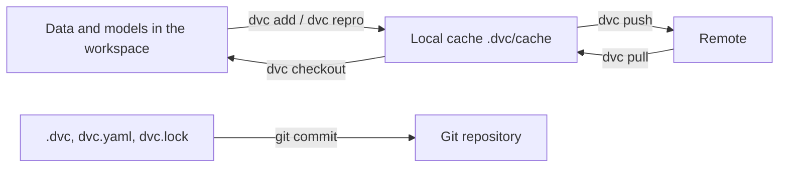

Datasets and model files do not belong in Git. A CSV of a few hundred megabytes, and a model larger than that, makes clone, diff, and rollback slow. DVC (Data Version Control) keeps those files outside Git, commits a small pointer instead, and uses the same idea for the training pipeline: when code, parameters, or data change, only the affected steps run again.

DVC does not replace Git. Git keeps the code and the pointers. DVC keeps the data, the models, and the pipeline outputs.

## What it is for

Day to day, that is four jobs:

- Version data and models. Each `dvc add` or pipeline rerun records a content hash that lines up with a Git commit.
- Sync those large files between machines. One copy lives in the local cache, another on a remote (disk, NFS, S3, SSH, or WebDAV).
- Turn "prepare data → train → write metrics" into a pipeline. Steps whose dependencies did not change are skipped.
- Switch data and models together with the code. After `git checkout`, run `dvc checkout`.

Git LFS can also replace a large file with a pointer, and the blob storage is usually tied to the Git host. A DVC remote can be object storage or an SSH machine you already operate, and the pipeline is part of the tool: it records which dataset, which script, and which parameters a training run depended on.

## How it works

The workspace, the local cache, and the remote each hold a copy of the data. Git holds only the pointers.



### Pointer files

`dvc add data/raw.csv` does three things: hash the file contents, store the file in `.dvc/cache`, write `data/raw.csv.dvc` beside it, and add `data/raw.csv` to `.gitignore`.

A pointer file looks like this (the hash and size are filled in by the command):

```yaml
outs:
- md5: 22a1a2931c8370d3aeedd7183606fd7f
  size: 1048576
  hash: md5
  path: raw.csv
```

The file is only a few lines, so it can be committed. After someone clones the repo they still do not have the CSV. `dvc pull` fetches the bytes from the remote by that hash.

Directories work the same way. `dvc add data/` tracks the whole directory. The cache stores each file plus a directory listing.

### Content-addressed storage

The cache lives in `.dvc/cache` and is stored by MD5 of the file contents, not by file name. Identical contents are stored once. Change one byte and the hash changes, so the cache gains a new object. The old object stays until you clean it up. Checking out an old commit restores the file as long as that hash is still in the cache or on the remote.

Workspace files are often hard links into the cache, and they are read-only, so editing the workspace does not overwrite a historical version in the cache. To change a tracked file, run `dvc unprotect`, edit it, then `dvc add` again.

### A pipeline records dependencies

A pipeline is `dvc.yaml`. Each stage has:

- `cmd`: the command to run
- `deps`: inputs, data files or code
- `params`: parameters read from `params.yaml`
- `outs`: data or models the command writes; DVC caches these
- `metrics`: a metrics file. With `cache: false` it stays out of the cache, and a small file can go straight into Git

`dvc repro` writes `dvc.lock`. The lockfile records the hash of every dependency and output from that run, and it should be committed. The next rerun compares the workspace with the hashes in the lock:

- Dependencies, parameters, and the command are unchanged: skip the stage
- An input to one stage changed: start at that stage and follow the graph downstream
- Before a stage runs, DVC deletes the `outs` that stage declared, then runs `cmd`. The script has to create its output directories, and it should overwrite output files rather than append to them

`dvc.yaml` says what to do. `dvc.lock` says what the last run produced. Both go into Git. The CSV and `model.pkl` go into the cache and the remote.

If a metrics file sets `cache: false`, its hash is still written to `dvc.lock` and the file itself stays in the workspace. You can run `dvc metrics diff` and compare AUC across two commits without pulling the data.

### Where configuration goes

`dvc init` creates `.dvc/`. Commit `.dvc/config`, which holds the remote URL. Write secrets to `.dvc/config.local`. That file is ignored by default.

One complete version is these four pieces:

| Where | What |
| --- | --- |
| Git | Code, `params.yaml`, `dvc.yaml`, `dvc.lock`, `*.dvc`, `.dvc/config` |
| `.dvc/cache` | Data and models, stored by hash |
| Remote | A copy of the cache, so other machines can `dvc pull` |
| `.dvc/config.local` | Credentials for the remote, not committed |

## Commands

The commands sit next to Git: one side commits pointers, the other pushes data.

### Init and remotes

```bash
dvc init

# Local disk or a shared mount. -d makes it the default remote
dvc remote add -d storage /mnt/dvc-storage

# Object storage. Install the plugin first, and keep credentials in the local config
# pip install dvc-s3
dvc remote add -d storage s3://team-ml/churn/dvc
dvc remote modify --local storage access_key_id 'AKIA...'
dvc remote modify --local storage secret_access_key '...'

dvc remote list
dvc remote default storage
```

An SSH remote is `ssh://user@host/data/dvc-cache`. Pick one remote for the team and commit its address in `.dvc/config`.

### Synology WebDAV as DVC storage

When a Synology NAS is already on the home or office LAN, DSM's WebDAV Server can be the DVC remote. Another machine then uses `dvc pull` to fetch the data and the model.

On the NAS:

1. Install **WebDAV Server** from Package Center. Enable HTTPS and leave the port at the default `5006`. On a LAN you can also enable HTTP on `5005`.
2. Control Panel → Shared Folder, and create a folder that holds only the cache, for example `dvc`. Turn the recycle bin off for that folder, so cleaning up old versions actually returns disk space.
3. Control Panel → User & Group, and create a user `dvc`. Grant that user read/write on the shared folder, and allow WebDAV Server in the user's application permissions.

In the project, install the WebDAV extra, commit the address, and keep the account on the machine:

```bash
pip install 'dvc[webdav]'

dvc remote add -d nas-webdav webdavs://192.168.1.20:5006/dvc
dvc remote modify --local nas-webdav user 'your-user'
dvc remote modify --local nas-webdav password 'your-password'
```

Replace `192.168.1.20` with the NAS address on the LAN. `dvc` is the shared folder name. For HTTP only, use `webdav://192.168.1.20:5005/dvc`.

DSM ships with a self-signed certificate. If `dvc push` fails on certificate verification, turn verification off for LAN use:

```bash
dvc remote modify nas-webdav ssl_verify false
```

If the NAS already has your own certificate, or you exported the CA, point `ssl_verify` at that pem file.

What you commit is `.dvc/config`:

```ini
[core]
    remote = nas-webdav
['remote "nas-webdav"']
    url = webdavs://192.168.1.20:5006/dvc
    ssl_verify = false
```

The account stays in `.dvc/config.local`, which is already ignored:

```ini
['remote "nas-webdav"']
    user = your-user
    password = your-password
```

Push and check it like any other remote:

```bash
dvc push
dvc status --cloud
```

If `dvc push` fails while listing directories, enable **Depth Infinity** in WebDAV Server and push again. A reverse proxy in front of port 443 has to allow uploads larger than a single model file. The built-in `5006` port has no such limit.

### Track data

```bash
dvc add data/raw.csv          # write the .dvc file, cache the data, ignore the original
dvc unprotect data/raw.csv    # make a read-only hard link writable before editing
dvc add data/raw.csv          # refresh the hash after the edit
dvc commit                    # copy workspace edits of tracked files back into the cache and update pointers
dvc remove data/raw.csv.dvc   # stop tracking the file and update the ignore rules
```

Use `dvc add` for new data, or to update a file tracked by its own `.dvc` file. Leave pipeline outputs alone. Change a dependency and run `dvc repro`.

### Sync and switch versions

```bash
dvc status            # workspace compared with the pointers
dvc status --cloud    # what the local cache is missing relative to the remote
dvc push              # cache → remote
dvc fetch             # remote → cache, workspace unchanged
dvc pull              # fetch, then checkout
dvc checkout          # restore the workspace from the cache using the pointers in the current Git commit
```

Switching code and switching data are two commands:

```bash
git checkout <commit>
dvc checkout
```

If the cache does not contain that hash, `dvc checkout` reports it missing. Run `dvc pull` next.

### Pipelines

Write `dvc.yaml` by hand, or generate it with `dvc stage add`. This is the same `train` stage as in the example below:

```bash
dvc stage add -n train \
  -d src/train.py -d data/train.csv -d data/test.csv \
  -p train \
  -o models/model.pkl \
  -M metrics.json \
  python src/train.py
```

`-M` declares a metrics file. The default is `cache: false`.

```bash
dvc repro                 # rerun stages whose dependencies changed, in graph order
dvc repro train           # check train and its upstream stages only
dvc repro --dry           # print the commands that would run
dvc dag                   # show the stage graph
dvc metrics show          # current metrics
dvc metrics diff HEAD     # compare workspace metrics with a commit
dvc params diff HEAD      # compare parameters
```

### Experiments and cache cleanup

When you are still trying parameters and do not want a commit yet, the experiment commands record a run and leave the workspace as it was:

```bash
dvc exp run -S train.max_depth=6
dvc exp show
dvc exp apply <experiment>   # bring that run back into the workspace, then commit it yourself
```

The local cache grows with every version. `dvc gc` deletes nothing unless you pass a scope. `-w` keeps only the objects referenced by the pointers in the current workspace, and drops other versions from the local cache:

```bash
dvc gc -w
```

Objects you already `dvc push`ed can be restored later with `dvc fetch`. `--cloud` deletes the remote with the same scope. Versions removed there are gone from that remote, so use it only after you are sure the old data can go.

## A typical example

The dataset below is for churn prediction. DVC tracks the raw CSV. Split and train are two stages. On another machine, `git clone` and `dvc pull` retrieve the same data and the same model.

Repository layout:

```text
.
├── data/
│   └── raw.csv
├── src/
│   ├── prepare.py
│   └── train.py
├── params.yaml
├── dvc.yaml
└── dvc.lock          # written by dvc repro
```

`data/raw.csv` needs feature columns and `label`. These three rows only show the shape. A real file needs enough rows of both labels, or one side of the split will be missing a class:

```csv
tenure,monthly_charges,label
3,29.85,0
12,56.95,0
1,89.10,1
```

`params.yaml`:

```yaml
prepare:
  test_size: 0.2
  seed: 7
train:
  max_depth: 4
  seed: 7
```

`src/prepare.py` reads the parameters and the raw data, and writes the two splits:

```python
from pathlib import Path

import pandas as pd
import yaml
from sklearn.model_selection import train_test_split


def main():
    with open("params.yaml") as f:
        params = yaml.safe_load(f)["prepare"]
    df = pd.read_csv("data/raw.csv")
    train, test = train_test_split(
        df,
        test_size=params["test_size"],
        random_state=params["seed"],
    )
    Path("data").mkdir(exist_ok=True)
    train.to_csv("data/train.csv", index=False)
    test.to_csv("data/test.csv", index=False)


if __name__ == "__main__":
    main()
```

`src/train.py` reads the splits and writes the model and the metrics:

```python
import json
from pathlib import Path

import joblib
import pandas as pd
import yaml
from sklearn.metrics import roc_auc_score
from sklearn.tree import DecisionTreeClassifier


def main():
    with open("params.yaml") as f:
        params = yaml.safe_load(f)["train"]
    train = pd.read_csv("data/train.csv")
    test = pd.read_csv("data/test.csv")
    features = [col for col in train.columns if col != "label"]

    model = DecisionTreeClassifier(
        max_depth=params["max_depth"],
        random_state=params["seed"],
    )
    model.fit(train[features], train["label"])
    proba = model.predict_proba(test[features])[:, 1]

    Path("models").mkdir(exist_ok=True)
    joblib.dump(model, "models/model.pkl")
    Path("metrics.json").write_text(
        json.dumps({"roc_auc": float(roc_auc_score(test["label"], proba))}, indent=2)
        + "\n"
    )


if __name__ == "__main__":
    main()
```

`dvc.yaml`:

```yaml
stages:
  prepare:
    cmd: python src/prepare.py
    deps:
      - src/prepare.py
      - data/raw.csv
    params:
      - prepare
    outs:
      - data/train.csv
      - data/test.csv
  train:
    cmd: python src/train.py
    deps:
      - src/train.py
      - data/train.csv
      - data/test.csv
    params:
      - train
    outs:
      - models/model.pkl
    metrics:
      - metrics.json:
          cache: false
```

### Track the data the first time

```bash
git init
dvc init
pip install dvc pandas scikit-learn pyyaml joblib

dvc add data/raw.csv
git add data/raw.csv.dvc data/.gitignore .dvc
git commit -m "track raw dataset with dvc"

dvc remote add -d storage /mnt/dvc-storage
git add .dvc/config
git commit -m "add dvc remote"
dvc push
```

If the Synology NAS is not mounted as a share, use the WebDAV remote from the previous section instead of `/mnt/dvc-storage`. The `git add` and `dvc push` steps stay the same.

At this point Git has the pointer and the remote address, and the remote has the CSV. `data/raw.csv` does not show up as a file to commit in `git status`.

### Run the pipeline and commit

After the scripts, `params.yaml`, and `dvc.yaml` are in place:

```bash
dvc repro
dvc metrics show
```

`dvc repro` runs `prepare`, then `train`, and writes `dvc.lock`. `data/train.csv`, `data/test.csv`, and `models/model.pkl` go into the cache. `metrics.json` stays in the workspace.

```bash
git add dvc.yaml dvc.lock params.yaml src metrics.json
git commit -m "add prepare and train stages"
dvc push
git push
```

Both `git commit` and `dvc push` have to happen. Pushing only Git tells others the hash, but they cannot fetch the file. Pushing only DVC leaves them without the hash to pull.

### Another machine

```bash
git clone git@github.com:org/churn.git
cd churn
dvc pull          # fetch raw.csv, the splits, and the model from the lockfile
dvc repro         # nothing changed, so both stages are skipped
```

### Change a parameter

Set `train.max_depth` in `params.yaml` from 4 to 8:

```bash
dvc repro
dvc metrics diff HEAD
dvc params diff HEAD
```

`prepare` is unchanged, so it is skipped. `train` sees a new parameter and runs again. After you accept the metrics:

```bash
git add dvc.lock params.yaml metrics.json
git commit -m "train with max_depth 8"
dvc push
```

When the data itself changes, edit `data/raw.csv` and run `dvc add data/raw.csv` again. Once the hash changes, `dvc repro` starts over from `prepare`.

To compare a few depths before committing:

```bash
dvc exp run -S train.max_depth=6
dvc exp show
```

Pick one run, bring it back with `dvc exp apply`, then commit and `dvc push` as above.

### Return to the previous version

```bash
git checkout HEAD~1
dvc checkout
```

Code, parameters, and `dvc.lock` return to the previous commit, and the CSV and model in the workspace return to that hash. That is the version you get by tying DVC to one Git commit.

Command details are in the [DVC Command Reference](https://doc.dvc.org/command-reference). Pipeline fields are in [dvc.yaml](https://doc.dvc.org/user-guide/project-structure/dvcyaml-files). Get "pointers in Git, contents on the remote, reruns decided by the lockfile" working before you add experiments and cache cleanup.
