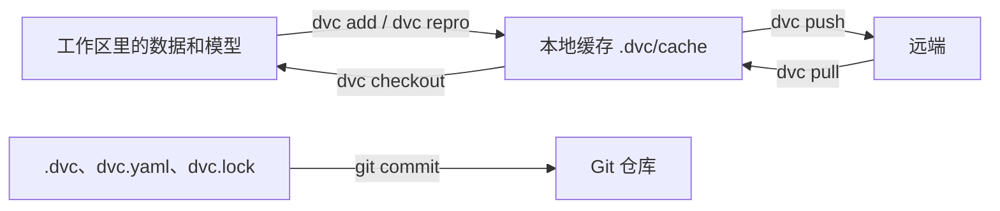

数据集和模型文件不适合进 Git。一份 CSV 几百 MB，模型再大一些，仓库克隆、diff、回滚都会变得很慢。DVC（Data Version Control）把这些大文件留在 Git 外面，只把一个很小的指针交进仓库，并用同一套思路描述训练流水线：代码、参数或数据变了，就只重跑受影响的步骤。

它不替换 Git。Git 继续管代码和指针，DVC 管数据、模型和流水线产物。

## 用来做什么

日常就这四件事：

- 给数据和模型做版本。每次 `dvc add` 或流水线重跑，都会留下内容哈希，能和某次 Git 提交对上。
- 在机器之间同步这些大文件。本地缓存一份，远端（磁盘、NFS、S3、SSH、WebDAV）再存一份。
- 把「准备数据 → 训练 → 写出指标」写成流水线。依赖没变的步骤不重跑。
- 换一版代码时，把对应的数据和模型一起换回来。`git checkout` 之后再 `dvc checkout`。

Git LFS 也能把大文件换成指针，存储一般绑在 Git 托管平台上。DVC 的远端可以是你已经在用的对象存储或一台 SSH 机器，并且自带流水线：它知道训练依赖哪份数据、哪个脚本、哪几个参数。

## 原理

工作区、本地缓存、远端各有一份数据。Git 里只有指针。



### 指针文件

`dvc add data/raw.csv` 做三件事：按文件内容算哈希，把文件放进 `.dvc/cache`，在旁边写下 `data/raw.csv.dvc`，并把 `data/raw.csv` 写进 `.gitignore`。

指针文件类似这样（哈希和大小由命令生成）：

```yaml
outs:
- md5: 22a1a2931c8370d3aeedd7183606fd7f
  size: 1048576
  hash: md5
  path: raw.csv
```

这个文件通常只有几行，可以提交。别人克隆仓库后看不到 CSV 本身，要执行 `dvc pull`，DVC 才按哈希去远端把内容取回来。

目录也一样。`dvc add data/` 会跟踪整个目录，缓存里除了每个文件，还有一份目录清单。

### 内容寻址

缓存放在 `.dvc/cache`，按文件内容的 MD5 存储，而不是按文件名。同一份内容只存一份。文件改了一个字节，哈希就变，缓存里会多一个新对象，旧对象还在，直到你清理。回到旧提交时，只要缓存或远端还留着那个哈希，文件就能恢复。

工作区里的文件经常是缓存的硬链接，并且是只读的，避免改工作区时把缓存里的历史版本一起改掉。要修改已跟踪的数据，先 `dvc unprotect`，改完再 `dvc add`。

### 流水线记的是依赖，不是“再跑一遍全部”

流水线写在 `dvc.yaml` 里，每一段叫一个 stage，包含：

- `cmd`：实际执行的命令
- `deps`：输入，数据文件或代码
- `params`：从 `params.yaml` 里依赖的参数
- `outs`：命令生成的数据或模型，DVC 会缓存
- `metrics`：指标文件。加上 `cache: false` 时不进缓存，小文件可以直接交给 Git

`dvc repro` 运行后生成 `dvc.lock`。锁文件记下这一次每个依赖和产物的哈希，也要提交。下次重跑时，DVC 对比工作区和锁里的哈希：

- 依赖、参数、命令都没变：跳过
- 某一段的输入变了：从那段开始，按依赖图往后跑
- 重跑前会先删除该阶段声明的 `outs`，再执行 `cmd`。脚本需要自己创建输出目录，也不要往产物文件里追加写

`dvc.yaml` 描述「要做什么」，`dvc.lock` 描述「上次做成了什么样」。两者都进 Git。真正的 CSV 和 `model.pkl` 进缓存和远端。

指标文件如果设了 `cache: false`，哈希仍然写在 `dvc.lock` 里，文件本身留在工作区。这样不拉数据也能 `dvc metrics diff`，比较两次提交的 AUC。

### 配置放哪

`dvc init` 会建立 `.dvc/`。需要提交的是 `.dvc/config`（远端地址）。密钥写到 `.dvc/config.local`，这个文件默认被忽略。

一次完整的版本包含四样东西，缺一就对不齐：

| 放在哪 | 内容 |
| --- | --- |
| Git | 代码、`params.yaml`、`dvc.yaml`、`dvc.lock`、`*.dvc`、`.dvc/config` |
| `.dvc/cache` | 数据、模型，按哈希存储 |
| 远端 | 缓存的副本，给别的机器 `dvc pull` |
| `.dvc/config.local` | 访问远端的密钥，不进 Git |

## 常用命令

命令和 Git 是平行的：一边提交指针，一边推送数据。

### 初始化和远端

```bash
dvc init

# 本机或共享盘。-d 设为默认远端
dvc remote add -d storage /mnt/dvc-storage

# 对象存储。先装对应插件，密钥只写本地配置
# pip install dvc-s3
dvc remote add -d storage s3://team-ml/churn/dvc
dvc remote modify --local storage access_key_id 'AKIA...'
dvc remote modify --local storage secret_access_key '...'

dvc remote list
dvc remote default storage
```

SSH 远端写成 `ssh://user@host/data/dvc-cache`。团队共用哪一种，就固定哪一种，地址写在 `.dvc/config` 里提交。

### 群晖 WebDAV 作为 DVC 存储

家里或办公室已经有群晖时，不必再挂一块共享盘。DSM 自带的 WebDAV Server 就能当 DVC 远端，另一台机器用 `dvc pull` 把数据和模型拉下来。

群晖上先准备目录和账号：

1. 套件中心安装 **WebDAV Server**。打开后启用 HTTPS，端口保持默认的 `5006`。只在局域网使用时可以同时开 HTTP `5005`。
2. 控制面板 → 共享文件夹，新建一个只放缓存的文件夹，例如 `dvc`。编辑该文件夹时关掉回收站，后面清理旧版本才能把磁盘空间还回来。
3. 控制面板 → 用户与群组，新建用户 `dvc`。共享文件夹权限给这个用户读写；用户的应用程序权限里允许 WebDAV Server。

项目里安装 WebDAV 插件，把地址写进仓库，把账号留在本机：

```bash
pip install 'dvc[webdav]'

dvc remote add -d nas-webdav webdavs://192.168.1.20:5006/dvc
dvc remote modify --local nas-webdav user '你的用户名'
dvc remote modify --local nas-webdav password '你的密码'
```

`192.168.1.20` 换成群晖的局域网地址，`dvc` 是共享文件夹名。只用 HTTP 时，协议和端口改成 `webdav://192.168.1.20:5005/dvc`。

DSM 默认证书是自签的。`dvc push` 报证书错误时，先把校验关掉，局域网里可以先这样用：

```bash
dvc remote modify nas-webdav ssl_verify false
```

已经给群晖装了自己的证书，或者导出了 CA 时，把 `ssl_verify` 指到那个 pem 文件，不必关掉校验。

提交进去的是 `.dvc/config`：

```ini
[core]
    remote = nas-webdav
['remote "nas-webdav"']
    url = webdavs://192.168.1.20:5006/dvc
    ssl_verify = false
```

账号在 `.dvc/config.local`，这个文件已经被忽略：

```ini
['remote "nas-webdav"']
    user = 你的用户名
    password = 你的密码
```

然后和别的远端一样：

```bash
dvc push
dvc status --cloud
```

`dvc push` 列目录失败时，到 WebDAV Server 里打开「启用 Depth Infinity」，再推一次。前面如果用反向代理转到 443，代理上的上传大小要大于单个模型文件，内置的 `5006` 端口没有这条限制。

### 跟踪数据

```bash
dvc add data/raw.csv          # 生成 .dvc，写入缓存，忽略原文件
dvc unprotect data/raw.csv    # 数据是只读硬链接时，改之前先解锁
dvc add data/raw.csv          # 改完后更新哈希
dvc commit                    # 已跟踪文件有改动时，把工作区写回缓存并更新指针
dvc remove data/raw.csv.dvc   # 停止跟踪，并处理对应的忽略规则
```

`dvc add` 用来纳入新数据，或更新一份由 `.dvc` 单独跟踪的文件。流水线产物不要手改，改依赖后用 `dvc repro`。

### 同步和切换版本

```bash
dvc status            # 工作区相对指针有没有变化
dvc status --cloud    # 本地缓存相对远端缺什么
dvc push              # 缓存 → 远端
dvc fetch             # 远端 → 缓存，不改工作区
dvc pull              # fetch 再 checkout
dvc checkout          # 按当前 Git 提交里的指针，从缓存恢复工作区
```

切代码和切数据是两条命令：

```bash
git checkout <commit>
dvc checkout
```

缓存里没有那个哈希时，`dvc checkout` 会提示缺失，接着 `dvc pull`。

### 流水线

可以手写 `dvc.yaml`，也可以用 `dvc stage add` 生成。下面这条和后文示例里的 `train` 阶段是一回事：

```bash
dvc stage add -n train \
  -d src/train.py -d data/train.csv -d data/test.csv \
  -p train \
  -o models/model.pkl \
  -M metrics.json \
  python src/train.py
```

`-M` 声明指标文件，默认 `cache: false`。

```bash
dvc repro                 # 按依赖图重跑有变化的阶段
dvc repro train           # 只检查 train 及其上游
dvc repro --dry           # 只打印会执行的命令
dvc dag                   # 看阶段依赖
dvc metrics show          # 当前指标
dvc metrics diff HEAD     # 工作区和某次提交比指标
dvc params diff HEAD      # 比参数
```

### 实验和缓存清理

参数还没想好、不想先提交时，用实验命令。它会记下一次运行，跑完把工作区留在原来的状态：

```bash
dvc exp run -S train.max_depth=6
dvc exp show
dvc exp apply <实验名>     # 把某次实验的结果拿回工作区，再自己 git commit
```

本地缓存会随版本变多。`dvc gc` 不带范围参数时什么都不删。`-w` 只保留工作区当前这份指针用到的对象，历史提交里的其他版本会从本地缓存去掉：

```bash
dvc gc -w
```

这些对象如果已经 `dvc push` 过，以后还能 `dvc fetch` 回来。`--cloud` 会按同样的范围删除远端，删掉的历史版本这块远端就没有了，确认不再需要旧数据再使用。

## 一个常用例子

下面是一份流失预测数据。原始 CSV 用 DVC 跟踪，切分和训练写成两个阶段。换机器时 `git clone` 加 `dvc pull` 就能拿到同一份数据和模型。

仓库结构：

```text
.
├── data/
│   └── raw.csv
├── src/
│   ├── prepare.py
│   └── train.py
├── params.yaml
├── dvc.yaml
└── dvc.lock          # dvc repro 之后生成
```

`data/raw.csv` 要有特征列和 `label`。下面三行只说明格式，真要跑通训练，两种 label 都得有足够行数，否则切分后某一边会缺类别：

```csv
tenure,monthly_charges,label
3,29.85,0
12,56.95,0
1,89.10,1
```

`params.yaml`：

```yaml
prepare:
  test_size: 0.2
  seed: 7
train:
  max_depth: 4
  seed: 7
```

`src/prepare.py` 只读参数和原始数据，写出两份切分结果：

```python
from pathlib import Path

import pandas as pd
import yaml
from sklearn.model_selection import train_test_split


def main():
    with open("params.yaml") as f:
        params = yaml.safe_load(f)["prepare"]
    df = pd.read_csv("data/raw.csv")
    train, test = train_test_split(
        df,
        test_size=params["test_size"],
        random_state=params["seed"],
    )
    Path("data").mkdir(exist_ok=True)
    train.to_csv("data/train.csv", index=False)
    test.to_csv("data/test.csv", index=False)


if __name__ == "__main__":
    main()
```

`src/train.py` 读切分结果，写模型和指标：

```python
import json
from pathlib import Path

import joblib
import pandas as pd
import yaml
from sklearn.metrics import roc_auc_score
from sklearn.tree import DecisionTreeClassifier


def main():
    with open("params.yaml") as f:
        params = yaml.safe_load(f)["train"]
    train = pd.read_csv("data/train.csv")
    test = pd.read_csv("data/test.csv")
    features = [col for col in train.columns if col != "label"]

    model = DecisionTreeClassifier(
        max_depth=params["max_depth"],
        random_state=params["seed"],
    )
    model.fit(train[features], train["label"])
    proba = model.predict_proba(test[features])[:, 1]

    Path("models").mkdir(exist_ok=True)
    joblib.dump(model, "models/model.pkl")
    Path("metrics.json").write_text(
        json.dumps({"roc_auc": float(roc_auc_score(test["label"], proba))}, indent=2)
        + "\n"
    )


if __name__ == "__main__":
    main()
```

`dvc.yaml`：

```yaml
stages:
  prepare:
    cmd: python src/prepare.py
    deps:
      - src/prepare.py
      - data/raw.csv
    params:
      - prepare
    outs:
      - data/train.csv
      - data/test.csv
  train:
    cmd: python src/train.py
    deps:
      - src/train.py
      - data/train.csv
      - data/test.csv
    params:
      - train
    outs:
      - models/model.pkl
    metrics:
      - metrics.json:
          cache: false
```

### 第一次把数据放进去

```bash
git init
dvc init
pip install dvc pandas scikit-learn pyyaml joblib

dvc add data/raw.csv
git add data/raw.csv.dvc data/.gitignore .dvc
git commit -m "track raw dataset with dvc"

dvc remote add -d storage /mnt/dvc-storage
git add .dvc/config
git commit -m "add dvc remote"
dvc push
```

群晖没有挂载成共享盘时，用前面的 WebDAV 远端代替 `/mnt/dvc-storage`，后面的 `git add` 和 `dvc push` 不变。

到这里，Git 里有指针和远端地址，远端里有 CSV 的内容。`data/raw.csv` 不会出现在 `git status` 的待提交列表里。

### 跑通流水线并提交

把上面的脚本、`params.yaml`、`dvc.yaml` 放好之后：

```bash
dvc repro
dvc metrics show
```

`dvc repro` 会先跑 `prepare`，再跑 `train`，并写下 `dvc.lock`。`data/train.csv`、`data/test.csv`、`models/model.pkl` 进入缓存；`metrics.json` 留在工作区。

```bash
git add dvc.yaml dvc.lock params.yaml src metrics.json
git commit -m "add prepare and train stages"
dvc push
git push
```

`git commit` 和 `dvc push` 都要做。只推 Git，别人知道哈希但拉不到文件。只推 DVC，别人看不到该用哪个哈希。

### 另一台机器

```bash
git clone git@github.com:org/churn.git
cd churn
dvc pull          # 按锁文件把 raw.csv、切分结果和模型拿回来
dvc repro         # 依赖没变，两个阶段都会跳过
```

### 改了参数

把 `params.yaml` 里的 `train.max_depth` 从 4 改成 8：

```bash
dvc repro
dvc metrics diff HEAD
dvc params diff HEAD
```

`prepare` 的依赖没变，会跳过。`train` 的参数变了，会重跑。确认指标后：

```bash
git add dvc.lock params.yaml metrics.json
git commit -m "train with max_depth 8"
dvc push
```

数据本身更新时，先改 `data/raw.csv`，再 `dvc add data/raw.csv`。哈希变了之后 `dvc repro` 会从 `prepare` 开始重跑。

想先对比几种深度、暂不提交：

```bash
dvc exp run -S train.max_depth=6
dvc exp show
```

看中某一次，再用 `dvc exp apply` 拿回工作区，按上面的方式提交和 `dvc push`。

### 回到上一版

```bash
git checkout HEAD~1
dvc checkout
```

代码、参数、`dvc.lock` 回到上一提交，工作区里的 CSV 和模型也回到当时的哈希。这就是 DVC 和一次 Git 提交绑在一起的用法。

官方命令说明在 [DVC Command Reference](https://doc.dvc.org/command-reference)，流水线字段在 [dvc.yaml](https://doc.dvc.org/user-guide/project-structure/dvcyaml-files)。先把「指针进 Git、内容进远端、重跑看锁文件」这条路径走通，再加实验和缓存清理。
